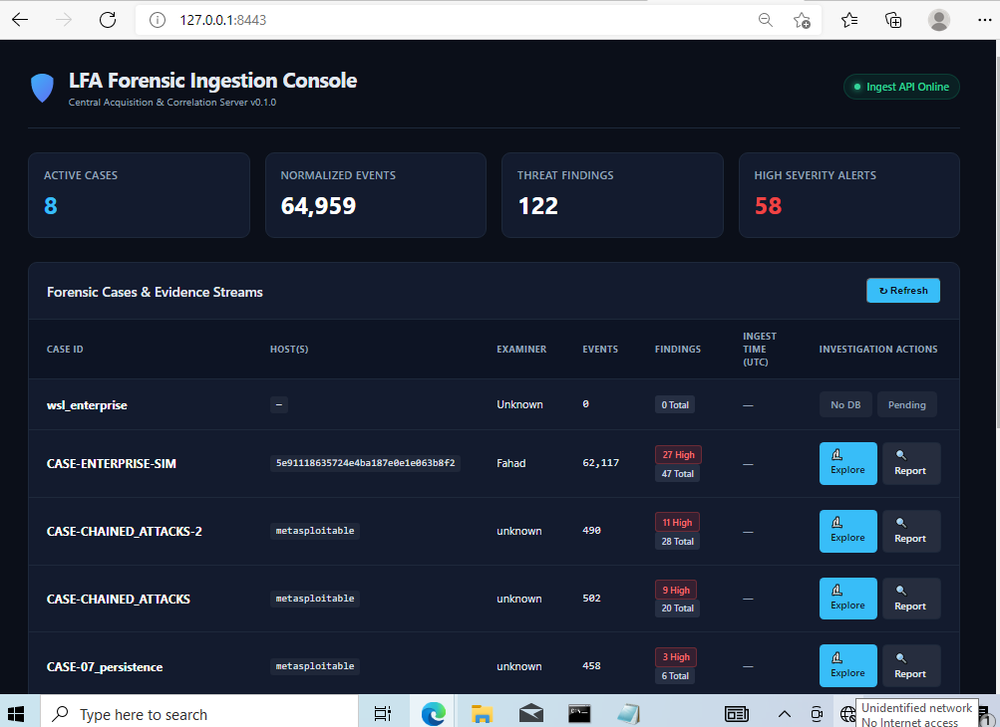
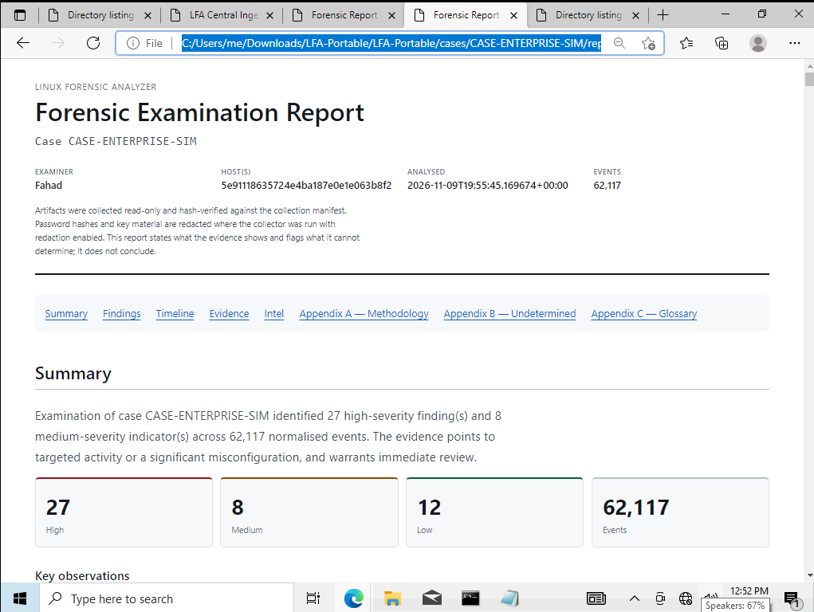

# Linux Forensic Analyzer (LFA)

LFA is a high-fidelity, deterministic forensic log collection, ingestion, correlation, and analysis engine for Linux environments.

The architecture is strictly separated into two sides:
1. **Collector (`collector/collect.sh`)** — Runs on the target/investigated Linux host (POSIX `sh`, minimal dependencies, zero Python/rsync required, tamper-evident).
2. **Analyzer / Server (`analyzer/lfa`)** — Runs on the forensic examiner / SOC workstation or central server (Python 3.11+, timeline reconstruction, threat correlation rules, interactive web dashboard, and offline HTML reports).

---

## Architecture Overview

```
                      TARGET / LIVE LINUX HOST
    +-------------------------------------------------------------+
    |  collector/collect.sh (POSIX sh, zero-install, in-memory)   |
    +-------------------------------------------------------------+
              |                                 |
              | (Direct HTTPS Stream / SSH)     | (Manual Tarball Transfer)
              v                                 v
    +-------------------------------------------------------------+
    |                     EXAMINER / SOC SERVER                   |
    |                                                             |
    |  1. Central Server:   python -m lfa serve                   |
    |  2. CLI Pipeline:     python -m lfa analyse <bundles...>    |
    |  3. Remote Ingest:    python -m lfa remote --host <target>  |
    |  4. Integrity Verify: python -m lfa verify <case_dir>       |
    |  5. Web UI & Report:  Interactive Dashboard & Offline HTML  |
    +-------------------------------------------------------------+
```

---

## Visual Showcase

| Central SOC Ingestion Console (`http://127.0.0.1:8443`) | Offline Forensic Examination Report (`report.html`) |
| :---: | :---: |
|  |  |

---

## Prerequisites & Installation

### 1. Collector (Target Side)
- Any Linux system (Debian/Ubuntu, RHEL/CentOS, Arch, Alpine, BusyBox, etc.)
- Standard POSIX shell (`/bin/sh`, `dash`, `bash`) and coreutils (`tar`, `sha256sum`, `cp`, `stat`).
- Root / sudo privileges for full artifact collection (`/etc/shadow`, `/var/log/*`, memory snapshots).

### 2. Analyzer (Examiner Side)
- Python 3.11+
- Install dependencies:
```bash
# Install required packages directly:
pip install -r requirements.txt
# Or install in editable mode:
pip install -e ./analyzer
```

---

## 1. Running the Collector (Target Host)

The collector script is located at [`collector/collect.sh`](collector/collect.sh).

### Basic Collection (Standard Archive)
Collect artifacts from the live system and save a compressed bundle:
```bash
sudo sh collector/collect.sh -o /tmp/output -c CASE-001 -p "Examiner Name" -z
```
*Output: `/tmp/output/lfa_CASE-001_<hostname>_<timestamp>.tar.gz` and `manifest.txt` with SHA-256 hashes.*

### In-Memory / RAM Mode (Zero Disk Forensics)
Stages collection in `/dev/shm` to avoid touching the target disk:
```bash
sudo sh collector/collect.sh -M -o /tmp -c CASE-001 -z
```

### Direct Streaming Ingestion over HTTPS
Stream evidence directly to a running LFA Central Server without saving the tarball to disk:
```bash
sudo sh collector/collect.sh -M -s "http://soc-server.corp.local:8443/api/v1/ingest" -T "SECRET_SOC_TOKEN" -c CASE-001
```

### Full Volatile Snapshot Mode
Collect volatile memory state (`/proc`, open network connections, running process tree) first before file collection:
```bash
sudo sh collector/collect.sh -V -z -o /tmp -c CASE-001
```

### Redacted Secrets Mode
Exclude credentials and hash content (`/etc/shadow`, `/etc/gshadow`) when handling sensitive environments:
```bash
sudo sh collector/collect.sh -R -z -o /tmp -c CASE-001
```

---

## 2. Running the Analyzer (Examiner / SOC Side)

The analyzer CLI is invoked using `python -m lfa <subcommand>`.

### Option A: Local Bundle Analysis (CLI Pipeline)
Ingests one or more collected `.tar.gz` bundles, parses artifacts, executes correlation rules, and generates an offline HTML report:
```bash
python -m lfa analyse /path/to/lfa_CASE-001_bundle.tar.gz --case-dir cases/CASE-001 --examiner "Jane Doe"
```
**Output generated in `cases/CASE-001/`:**
- `case.db` — SQLite database with normalized forensic events & findings.
- `report.html` — Self-contained, offline interactive HTML forensic report with SVG charts.
- `canonical/events.json` — SHA-256 verifiable canonical JSON timeline.
- `canonical/csv/` — Per-category CSV exports.

### Option B: Central Server & Live SOC Dashboard
Start the central ingestion server that accepts streaming uploads from collectors and serves the SOC web dashboard:
```bash
# 1. Local examiner review (loopback, open):
python -m lfa serve --host 127.0.0.1 --port 8443 --cases-dir cases

# 2. Production streaming server (non-loopback, mandatory bearer token):
python -m lfa serve --host 0.0.0.0 --port 8443 --token "SECRET_SOC_TOKEN" --cases-dir cases
```
- Open browser at `http://127.0.0.1:8443` for the interactive case dashboard, artifact tree, raw log line inspector, and timeline explorer.
- When target hosts upload bundles, the server automatically verifies hashes, parses logs, and creates case reports.

### Option C: Standalone Portable Windows Kit (Zero-Install)
For air-gapped forensic workstations or field laptops without Python or admin privileges:
```cmd
cd dist\LFA-Portable

# 1. Verify bundle integrity:
verify-install.cmd

# 2. Run analysis CLI:
lfa.cmd analyse <bundle.tar.gz> --case-dir cases\<CASE_ID> --examiner "Examiner Name"

# 3. Launch investigation dashboard:
lfa-dashboard.cmd
```
*(To build from source, see [docs/PORTABLE_BUILD.md](docs/PORTABLE_BUILD.md)).*

### Option D: Agentless Remote Acquisition via SSH
Stream and analyze evidence directly from a remote target over SSH in a single command (no script saved on target disk):
```bash
python -m lfa remote --host 192.168.1.50 --user root --case-dir cases/REMOTE-001 --examiner "Jane Doe"
```

---

## 3. Evidence Verification & Re-Reporting

### Verify Raw Evidence Integrity
Re-verify all raw collected files against the tamper-evident SHA-256 hashes in the manifest:
```bash
python -m lfa verify cases/CASE-001
```

### Re-render Forensic Report
Re-generate the HTML report from an existing SQLite case database (e.g. after rule updates):
```bash
python -m lfa report cases/CASE-001 --out cases/CASE-001/updated_report.html
```

### Export Canonical Datasets
Export deterministic JSON and CSV datasets for external SIEM / data science analysis:
```bash
python -m lfa export cases/CASE-001 --out-dir exports/CASE-001
```

---

## 4. End-to-End Workflow Examples

### Example 1: Offline Manual Triage
1. **On Target Linux Host:**
   ```bash
   sudo sh collector/collect.sh -o /mnt/usb -c INCIDENT-42 -p "Alice" -z
   ```
2. **Transfer the bundle to Examiner Workstation.**
3. **On Examiner Workstation:**
   ```bash
   python -m lfa analyse /mnt/usb/lfa_INCIDENT-42_server1.tar.gz --case-dir cases/INCIDENT-42 --examiner "Bob"
   # Open the report in your browser:
   # cases/INCIDENT-42/report.html
   ```

### Example 2: Live Ingest & Remote Investigation
1. **Start Central LFA Server:**
   ```bash
   python -m lfa serve --port 8443 --token "supersecret123"
   ```
2. **Trigger Remote Push on Target:**
   ```bash
   sudo sh collector/collect.sh -M -s "http://192.168.1.100:8443/api/v1/ingest" -T "supersecret123" -c INCIDENT-99
   ```
3. **View Results:**
   - Navigate to `http://192.168.1.100:8443` to explore timeline events, threat detections, and forensic artifacts in real time.

### Example 3: Enterprise Intrusion Simulation & Automated Benchmark
Execute an end-to-end 10-stage attack simulation with background corporate noise and evaluate detection accuracy:
1. **On Target Linux Host (Lab VM / WSL):**
   ```bash
   # Run the 10-stage enterprise attack scenario with benign noise
   sudo sh testlab/scenarios/mega_chain.sh

   # Collect the evidence bundle
   sudo sh collector/collect.sh -r / -o cases/wsl_enterprise -c CASE-ENTERPRISE-SIM -p "Fahad" -V -z
   ```
2. **On Examiner Workstation:**
   ```bash
   # Analyse and correlate
   python -m lfa analyse cases/wsl_enterprise/*.tar.gz --case-dir cases/CASE-ENTERPRISE-SIM --examiner "Fahad"

   # Verify evidence cryptographic integrity
   python -m lfa verify cases/CASE-ENTERPRISE-SIM

   # Score detections against ground truth
   python tools/score_detection.py --case-dir cases/CASE-ENTERPRISE-SIM --ground-truth testlab/scenarios/mega_chain.ground_truth.json
   ```

---

## 5. Documentation & Technical Reports

- **[Forensic Incident Investigation & Technical Walkthrough Report](docs/FORENSIC_INVESTIGATION_AND_WALKTHROUGH_REPORT.md)** ([Word Document](docs/FORENSIC_INVESTIGATION_AND_WALKTHROUGH_REPORT.docx)) — Master unified report combining the authentic cybercrime incident response (Task 3: 8 attack vectors, initial hypotheses, correlation, root causes, tool comparison) and complete technical walkthrough (Task 4: 29 visual evidence screenshots, acquisition, SOC explorer, engineering troubleshooting, and analyst SOP).
- **[Viva & Presentation Preparation Guide](docs/VIVA_PREP.md)** — Exhaustive technical Q&A covering forensic fundamentals, RFC 3227, parser architecture, correlation engine rules, and defense strategies for academic or supervisor evaluation.
- **[Building the Portable Offline Analyzer](docs/PORTABLE_BUILD.md)** — Technical specification and build process for the self-contained Windows x64 forensic kit.
- **[Changelog & Architecture Updates](docs/CHANGELOG_AND_ARCHITECTURE_UPDATES.md)** — Complete chronological log of features, schema updates, and performance optimizations.
- **[Forensics Framework Deep-Dive](FORENSICS_FRAMEWORK.md)** — Comprehensive forensic methodology, parser specifications, and evidence handling guidelines.
- **[Attack Scenarios & Playbook](testlab/scenarios/PLAYBOOK.md)** — Step-by-step incident-by-incident reproduction guides for lab validation.

---

## Running the Test Suite

Run the full automated test suite (250+ unit and integration tests):
```bash
python -m pytest
```

Score detections against attack ground truth:
```bash
python tools/score_detection.py --case-dir cases/SYNTH-001 --ground-truth testlab/ground_truth.json
```
